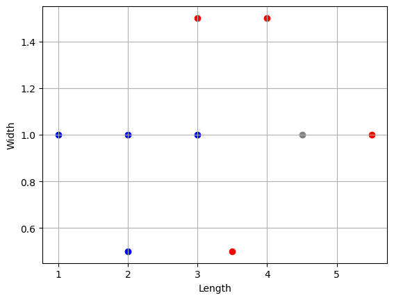
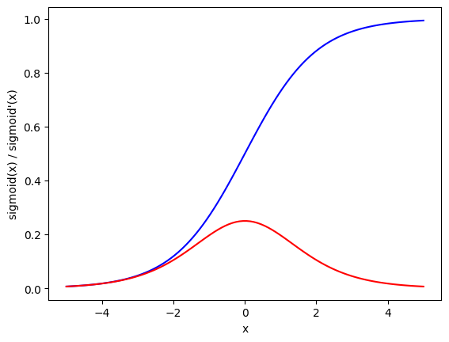
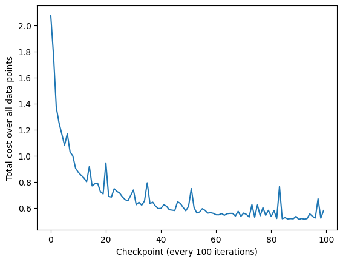
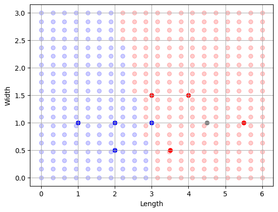

# Flowers — Teaching a Single Neuron to Tell Two Flowers Apart

![Beginner intro to neural networks]

This project is the "hello world" of neural networks. There's no deep learning
library, no GPU, no 50-layer architecture — just plain Python, `numpy`, and
about 40 lines of math. The goal is to understand, from first principles,
*what a neuron actually does* and *how it learns*. Everything below is
written so that by the end, the problem — and the solution — feels obvious.

---

## 1. The problem, in plain English

Imagine you're looking at a flower and you can measure exactly two things
about it:

- its **length**
- its **width**

Based on just these two numbers, you want to guess which of two **types**
the flower belongs to — call them "red" and "blue". You're given 8 flowers
whose type you already know (the training data), and one mystery flower
whose type you *don't* know:

| Length | Width | Type        |
|--------|-------|-------------|
| 3.0    | 1.5   | 🔴 red (1)   |
| 2.0    | 1.0   | 🔵 blue (0)  |
| 4.0    | 1.5   | 🔴 red (1)   |
| 3.0    | 1.0   | 🔵 blue (0)  |
| 3.5    | 0.5   | 🔴 red (1)   |
| 2.0    | 0.5   | 🔵 blue (0)  |
| 5.5    | 1.0   | 🔴 red (1)   |
| 1.0    | 1.0   | 🔵 blue (0)  |

Test Data
| **4.5**| **1.0**| ❓ **mystery flower** |
| **2.0**| **1.5**| ❓ **mystery flower** |

Plotting these on a graph (length on the x-axis, width on the y-axis), the
picture looks like this:



Red dots cluster to the right (longer flowers), blue dots cluster to the
left (shorter flowers), and the gray dot is our mystery flower sitting
somewhere in between. Just by eye, you'd probably guess the mystery flower
is red — it's long enough. The whole point of this project is to build a
tiny machine that makes that same guess automatically, and *proves* it with
numbers instead of a hunch.

---

## 2. What is a neuron, really?

The word "neuron" borrows from biology, so it helps to start there before
jumping into code.

A **biological neuron** in your brain works like a tiny decision-maker:
- It has many **input wires (dendrites)** bringing in signals from other neurons.
- Each incoming signal is more or less important — some connections are
  "stronger" than others.
- The neuron adds up all these weighted signals.
- If the combined signal is strong enough, the neuron "fires" (sends its own
  signal onward). If not, it stays quiet.

An **artificial neuron** is a deliberately simplified cartoon of this idea:

- Instead of dendrites, it has **numeric inputs** (here: length and width).
- Instead of "some connections are stronger," each input gets a **weight**
  (a number) that says how much that input matters.
- Instead of "fires or stays quiet," it computes one number between 0 and 1
  that represents *how confident it is* that the answer is "red" — 0 means
  "definitely blue", 1 means "definitely red", and anything in between is a
  degree of confidence.

That's it. A neuron is just: *multiply each input by how much you care
about it, add them up, add a little built-in bias, and squash the result
into a 0–1 confidence score.*

### The network for this problem

We only need **one neuron** here, because the problem only has two inputs
and one yes/no-ish answer. In diagram form:

```
      o   <- output neuron: "how confident is this flower red?"
     / \     weights w1, w2  +  bias b
    o   o  <- the two inputs: length, width
```

- `w1` is a number that says *how much length matters* for deciding red vs blue.
- `w2` is a number that says *how much width matters*.
- `b` (the **bias**) lets the neuron shift its decision threshold — think of
  it as the neuron's own built-in "leaning" independent of the inputs,
  similar to a y-intercept in a straight line equation.

Training the network means **finding good values for `w1`, `w2`, and `b`** —
nothing else. There is no architecture to design, no layers to stack. The
entire "intelligence" of this model lives in three numbers.

---

## 3. From a raw number to a confidence score: the sigmoid function

If we just compute `z = w1 * length + w2 * width + b`, we get *some* number —
but it could be anything: -17, 0.3, 203. That's not a useful "confidence",
because confidence should always live between 0 and 1.

The **sigmoid function** squashes any real number into that 0–1 range:

```
sigmoid(z) = 1 / (1 + e^-z)
```

- Very negative `z` → sigmoid outputs something close to **0** (confidently blue).
- Very positive `z` → sigmoid outputs something close to **1** (confidently red).
- `z` near 0 → sigmoid outputs close to **0.5** (not sure either way).

Visually, it's a smooth "S"-shaped curve (plotted in blue below). We also
need the sigmoid's **derivative** — a measure of *how fast sigmoid's output
changes* at any point — because that's what lets the network learn later.
The derivative is plotted in red; notice it peaks in the middle (where small
changes in `z` matter most) and flattens out at the extremes (where the
neuron is already very confident and barely budges):



Intuitively: the derivative being near-zero at the far left/right means
*"once the neuron is very sure, nudging it slightly doesn't change its mind
much"* — which matches how confidence should behave.

---

## 4. Making one guess (the forward pass)

For a single flower with a given `length` and `width`, the neuron's guess is
computed in two simple steps:

1. **Weighted sum:** `z = w1 * length + w2 * width + b`
2. **Squash into confidence:** `pred = sigmoid(z)`

`pred` is a number between 0 and 1. We read it as: *close to 0 → the network
thinks "blue"; close to 1 → the network thinks "red."*

Of course, with random `w1`, `w2`, `b`, this first guess will be nonsense.
The network hasn't learned anything yet — it's about to.

---

## 5. How wrong were we? (the cost function)

To learn, the network first needs a way to *measure* how wrong a guess was.
We use the simplest possible measure, the **squared error**:

```
cost = (pred - target)²
```

- `target` is the real, known answer (0 for blue, 1 for red).
- If `pred` and `target` are close, `cost` is small.
- If `pred` and `target` are far apart, `cost` is large (and squaring makes
  big mistakes count *extra* heavily, which pushes the network to fix large
  errors fast).

Training a neural network, at its core, is nothing more than **repeatedly
nudging `w1`, `w2`, and `b` in whatever direction makes this cost smaller.**

---

## 6. Learning: going downhill (gradient descent + backpropagation)

Here's the key intuition, with no calculus notation required first:

> Imagine the "cost" as your height on a hilly landscape, where the hills
> are shaped by `w1`, `w2`, and `b`. You are standing somewhere on this
> landscape in thick fog — you can't see the whole shape, but you *can* feel
> which direction is downhill from exactly where you're standing. If you
> keep taking small steps downhill, you'll eventually reach a valley — a low
> point where the cost is small, meaning your predictions are good.

"Feeling which direction is downhill" is exactly what a **derivative**
tells you — it's the local slope. Since our cost depends on `w1`, `w2`,
and `b` *through several chained steps* (weighted sum → sigmoid → squared
error), we use the **chain rule** from calculus to work the slope backwards
through each step — one multiplication at a time:

1. How much does the cost change as the prediction changes? (`dcost/dpred`)
2. How much does the prediction change as `z` changes? (`dpred/dz`, i.e. the
   sigmoid derivative we plotted earlier)
3. How much does `z` change as each weight changes? (`dz/dw1`, `dz/dw2`,
   `dz/db` — these turn out to just be the inputs themselves, and 1 for the
   bias)

Multiplying these chained slopes together tells us exactly how much — and in
which direction — to adjust each of `w1`, `w2`, `b` to make the cost a
little smaller. This backward flow of "blame" from the final error back to
each individual weight is called **backpropagation**. Each weight is then
nudged by a small amount (the **learning rate**, here `0.1`) in the
downhill direction:

```
w1 = w1 - learning_rate * (slope of cost w.r.t. w1)
w2 = w2 - learning_rate * (slope of cost w.r.t. w2)
b  = b  - learning_rate * (slope of cost w.r.t. b)
```

We repeat this — pick one random flower, make a guess, measure the error,
walk one small step downhill — **10,000 times**. Every 100 steps, we check
the total cost across *all* flowers (not just the one we happened to look
at) to track whether the network is actually improving overall:



The cost starts high (around 2.0 — essentially random guessing) and rapidly
drops, settling into a noisy but much lower band (around 0.5–0.6). The
noise never fully disappears because the network only ever looks at *one*
random flower per step — some steps happen to land on an "easy" or "hard"
example — but the clear downward trend is the network visibly learning.

---

## 7. Did it actually learn something useful?

The real test isn't the cost number — it's whether the network's *decision
boundary* (the line it draws between "I'd call this red" and "I'd call this
blue") actually matches the real data. We can check this by asking the
trained network to make a prediction for *every* point on the length-width
plane, not just our 8 training flowers, and coloring the background by its
answer:



The background splits cleanly into a blue region (left) and a red region
(right) — and every one of our original training dots falls into the
region matching its real color. The network has learned a sensible rule
(roughly: "longer flowers are more likely red"), using nothing but
trial-and-error nudging of three numbers.

---

## 8. So, what about the mystery flower?

Our mystery flower had `length = 4.5`, `width = 1.0`. Feeding it through the
trained network:

```
z = w1 * 4.5 + w2 * 1.0 + b
pred = sigmoid(z)   # ≈ 0.988
```

A prediction of **0.988** is extremely close to 1, so the network is highly
confident the mystery flower is **red** — exactly matching what the decision
boundary plot shows (the gray dot sits firmly inside red territory), and
exactly what our eyes guessed back in Section 1. We built a tiny machine
that reached the same conclusion as human intuition, purely by learning
from examples.


Another mystery flower had `length = 2.0`, `width = 1.5`. Feeding it through the
trained network:

```
z = w1 * 2.0 + w2 * 1.5 + b
pred = sigmoid(z)   # ≈ 0.24
```

A prediction of **0.24** is close to 0 , so the network is highly
confident the mystery flower is **blue** — exactly matching what the decision
boundary plot shows (the gray dot sits firmly inside red territory), and
exactly what our eyes guessed back in Section 1. We built a tiny machine
that reached the same conclusion as human intuition, purely by learning
from examples.

---

## 9. Why this example actually matters

This single neuron is, mathematically, a miniature version of what every
layer in a giant modern neural network does:

- Take some inputs.
- Multiply each by a learned weight, add a learned bias.
- Squash the result through an activation function (sigmoid, or in modern
  networks, often ReLU/GELU/etc.).
- Measure how wrong the output was.
- Use the chain rule to push the error backward and nudge every weight a
  tiny bit toward "less wrong."
- Repeat, a lot.

Stack thousands of these neurons into layers, feed them images or text
instead of two flower measurements, and this is — at its mathematical core —
the same process that powers image recognition, language models, and
everything in between. The "giant neural network" cover image at the top of
this README is simply this same idea, repeated at massive scale.

---
